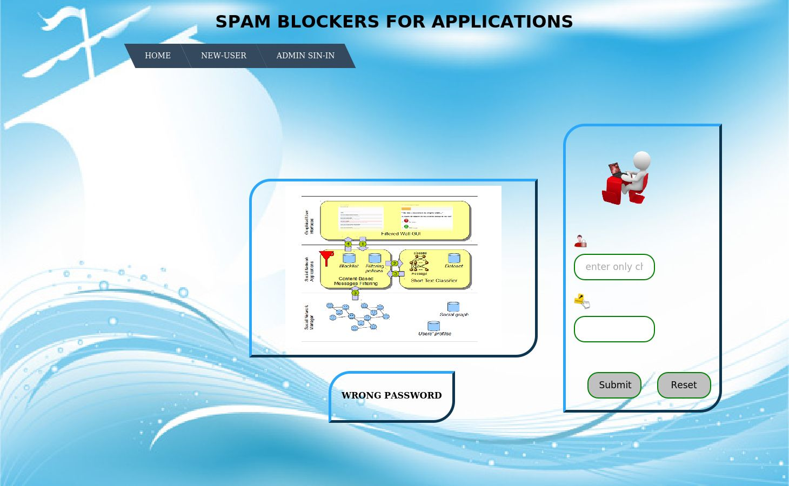
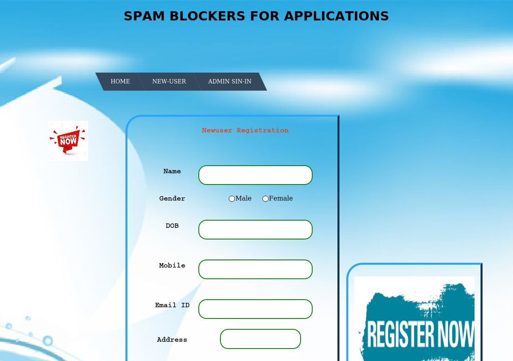
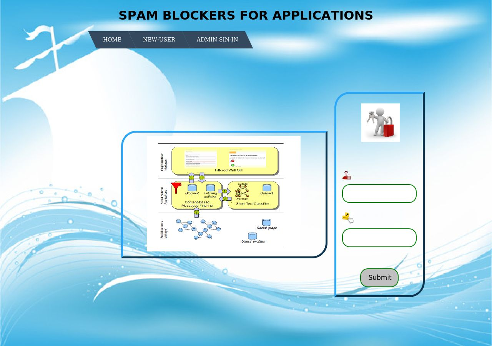
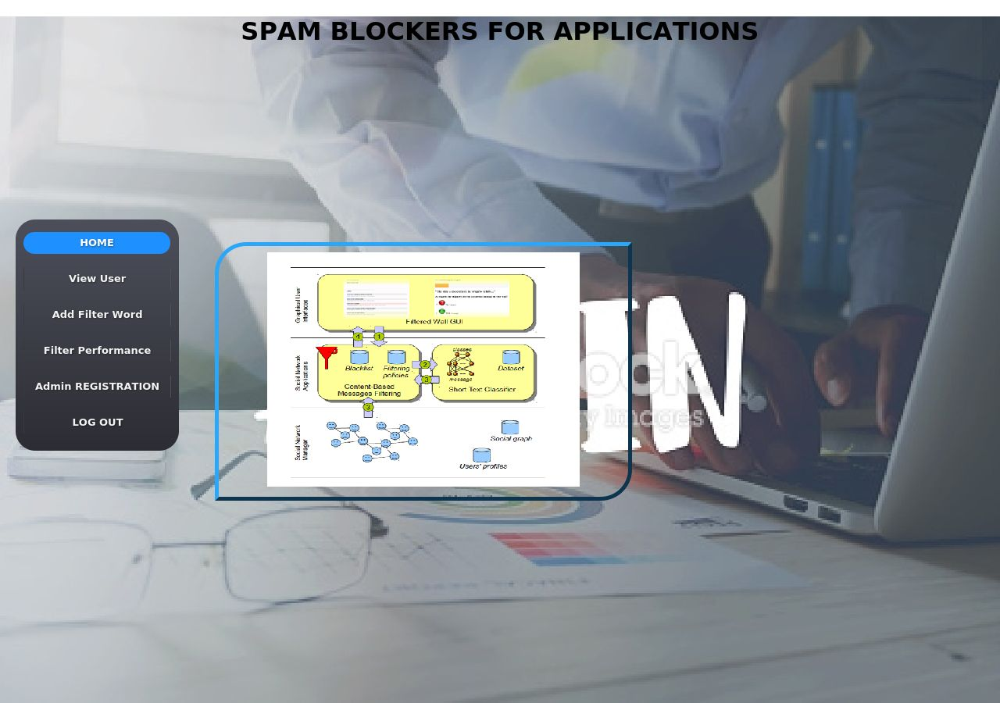
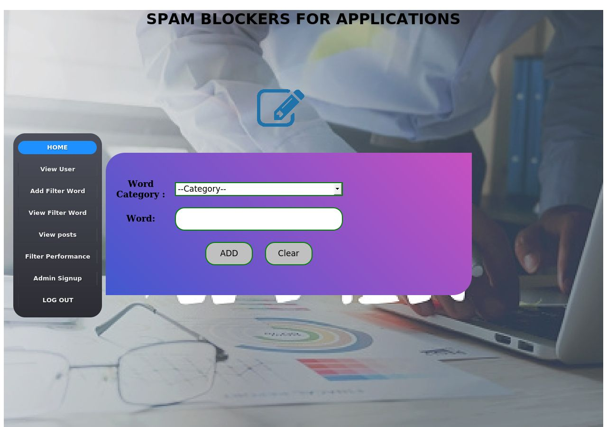
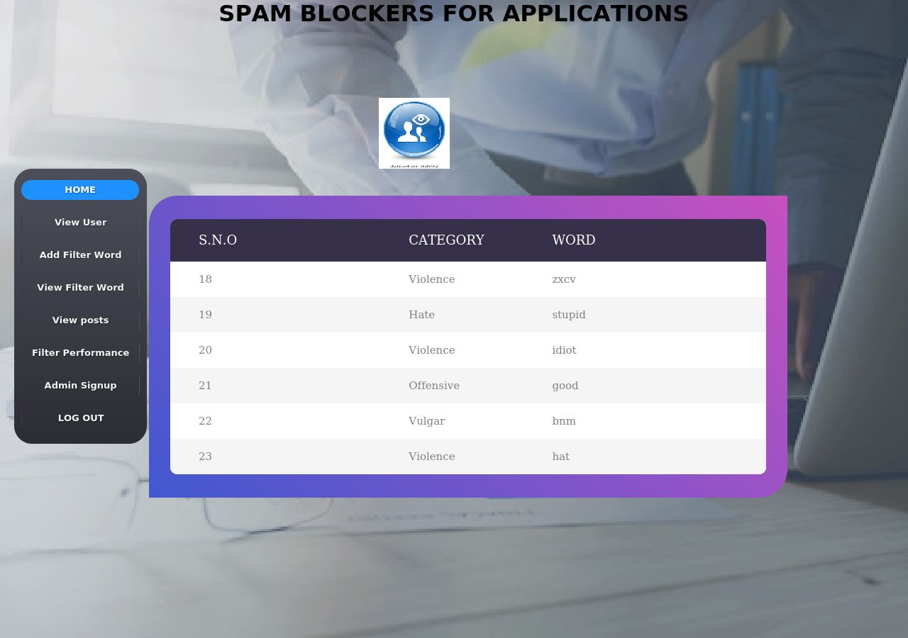
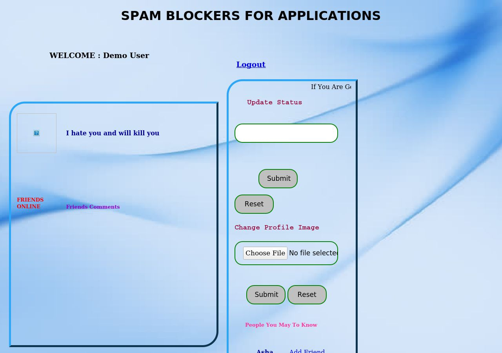
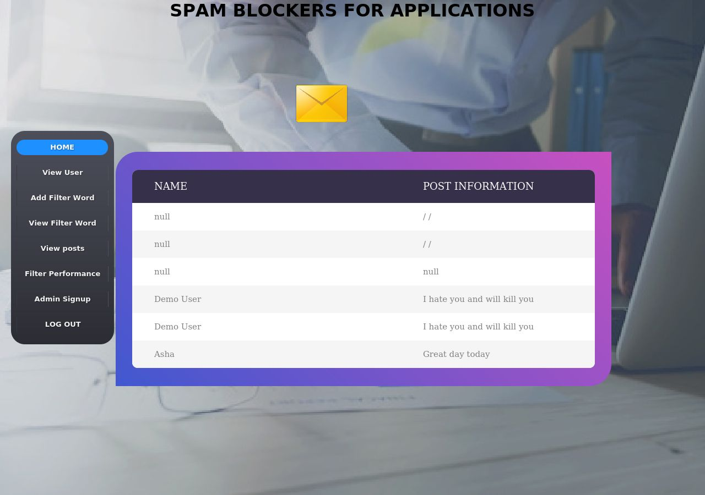
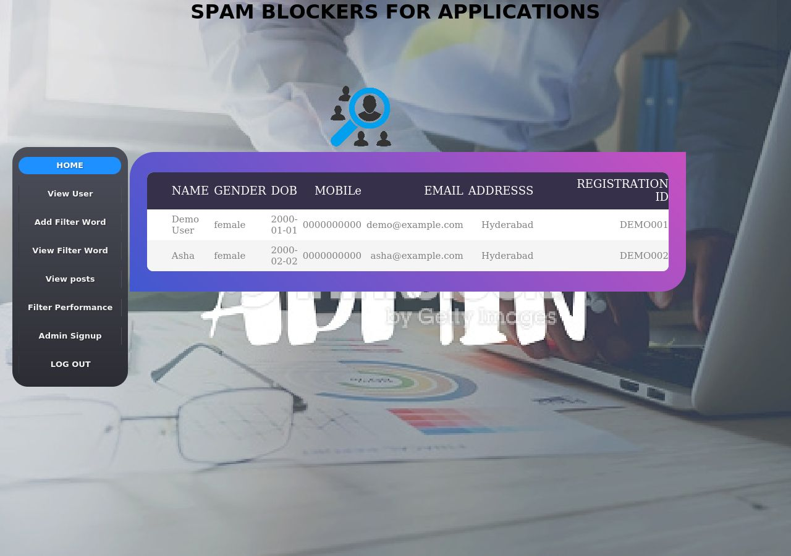
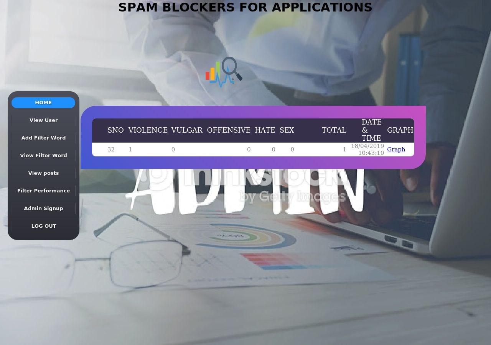

# Spam Blockers for Applications

A Java web application that filters unwanted messages on a social-network style user wall. Admins maintain a blacklist of words grouped into categories (Violence, Vulgar, Offensive, Hate, Sex). When a user posts a status, the message is checked word by word against that blacklist, and the matches are counted per category.

Built with JSP, Java, JDBC, Apache Tomcat and MySQL.

## Screenshots

| Home | User registration |
|------|-------------------|
|  |  |

| Admin login | Admin dashboard |
|-------------|-----------------|
|  |  |

| Add filter word | View filter words |
|-----------------|-------------------|
|  |  |

| User home (post a status) | Admin: view posts |
|---------------------------|-------------------|
|  |  |

| Admin: view users | Admin: filter performance |
|-------------------|---------------------------|
|  |  |

## Features

**User**
- Register and log in
- Post a status on the wall; the text is checked against the admin's blacklist
- Add friends, send chat messages, view friends' comments
- Update profile image

**Admin**
- Log in and register other admins
- View registered users
- Add and view blacklist words by category (Violence, Vulgar, Offensive, Hate, Sex)
- View all posts
- View filter performance (counts per category) and a graph

## How the filter works

1. The admin adds words to the blacklist, each under one category (`filtermessage` table).
2. When a user submits a status, `message_filter.jsp` splits the text into words.
3. Each word is compared (case-insensitive) with the blacklist words of every category.
4. The number of matches and the matched words are counted per category.

## Tech stack

- Java (JDK 8), JSP, JDBC
- Apache Tomcat 9
- MySQL 5.x
- Libraries bundled in the WAR: MySQL Connector/J, COS multipart (file upload), JavaMail
- Tools used: Eclipse IDE, SQLyog

## Prerequisites

| Tool | Version | Download |
|------|---------|----------|
| JDK | 8 | https://www.oracle.com/java/technologies/javase/javase8-archive-downloads.html |
| Apache Tomcat | 9.x (not 10+, the app uses `javax.*`) | https://tomcat.apache.org/download-90.cgi |
| MySQL | 5.x | https://dev.mysql.com/downloads/mysql/ |

## Setup and run

1. **Clone the repo**
   ```bash
   git clone https://github.com/creative-varsha/Spam-Blocker-For-Applications.git
   cd Spam-Blocker-For-Applications
   ```
2. **Create the database.** Import `database/database.sql` into MySQL. It creates the `message_filter` database with all tables, a default admin account and a few sample blacklist words.
   ```bash
   mysql -u root -p < database/database.sql
   ```
3. **Check the DB connection.** `src/databaseconnection/databasecon.java` connects to `jdbc:mysql://localhost:3306/message_filter` with user `root` and password `root`. If your MySQL password is different, change it there and rebuild (or edit the same file inside the WAR under `WEB-INF/classes`).
4. **Deploy.** Copy `spam-blocker.war` into Tomcat's `webapps` folder and start Tomcat (`bin/startup.bat` on Windows).
5. **Open** http://localhost:8080/spam-blocker

## Default login

| Role | Username | Password |
|------|----------|----------|
| Admin | `admin` | `admin` |
| User | register from the **NEW-USER** page | |

Change the default admin password before using this anywhere beyond local testing.

## Project structure

```
├── spam-blocker.war            # Deployable package (built from WebContent)
├── WebContent/                 # JSP pages, CSS, images, WEB-INF (libs, web.xml)
├── src/databaseconnection/     # Java source for the DB connection class
├── database/database.sql       # Schema + default admin + sample blacklist words
└── screenshots/
```

## Known limitations

- Passwords are stored in plain text.
- SQL queries are built by string concatenation, so the app is open to SQL injection. Use `PreparedStatement` before any real deployment.
- Database credentials are hard-coded in `databasecon.java`.
- Built for learning and demonstration, not production use.

## Author

**Varsha Kukunoori**
GitHub: [@creative-varsha](https://github.com/creative-varsha)
